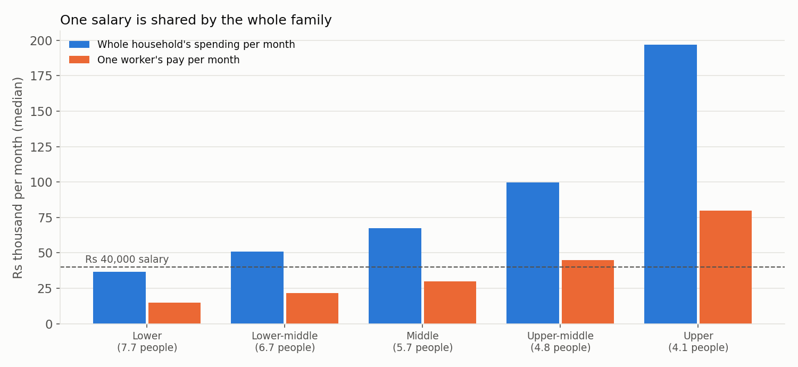
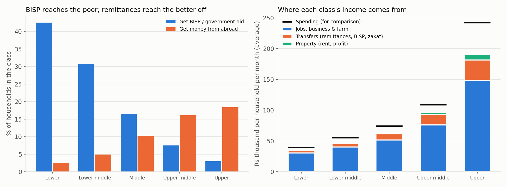
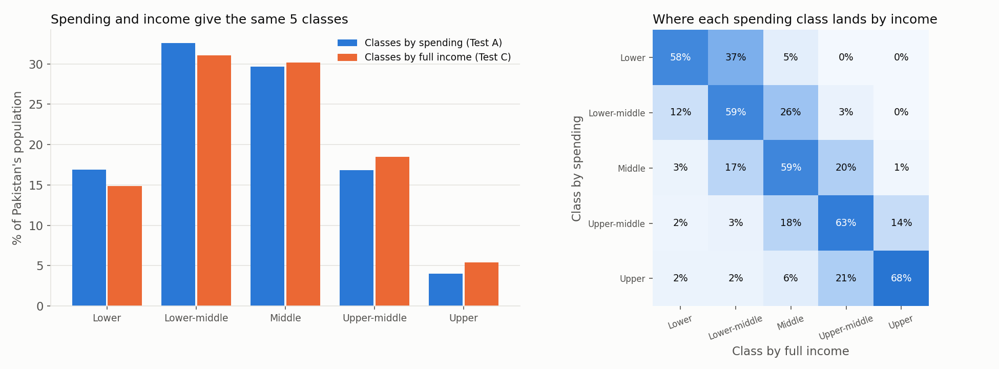

# Experiment 1: Five social classes from household spending (HIES 2024-25)

**Notebook:** [`social_classes_kmeans_knn.ipynb`](social_classes_kmeans_knn.ipynb). It has already been run, so the outputs are visible without re-running.

**Question:** Using Section 6A (consumption expenditure) and the survey weights, can machine learning divide Pakistan into 5 classes, and how many people fall in each?

## Method

1. Add up each household's spending from about 285 items, converted to a monthly amount, then divide by household size.
2. Run **K-means with weights** to create 5 classes. KNN cannot create classes, because it needs labels to learn from.
3. Use **KNN** to test whether the classes can be recognised from the household's spending pattern.

Every result uses `weight.dta`, weighted by people (household weight × household size).

## Result

| Class | Spending per person per month | % of people | People |
|---|---|---:|---:|
| Lower | below Rs 6,440 | 16.9% | 40.5 M |
| Lower-middle | Rs 6,440 – 10,287 | 32.6% | 78.2 M |
| Middle | Rs 10,288 – 16,882 | 29.7% | 71.2 M |
| Upper-middle | Rs 16,885 – 34,370 | 16.8% | 40.3 M |
| Upper | above Rs 34,408 | 4.0% | 9.6 M |

- **Most people are in the middle:** 62% are lower-middle or middle. Only 4% form a distinct upper class.
- **KNN recognises the class** from the spending pattern for 84.5% of people. All its mistakes are to a neighbouring class.
- **Clustering on *what* people buy** (12 categories) finds household types (smokers vs non-smokers, families with or without students), not classes.
- **Weights are required** for results that describe Pakistan. For these national shares they changed each class by only about 1 point, but they matter more for provinces.

## Adding income (Section 1B)

The class boundaries are **spending per person**, not salaries. A household's money is shared by everyone in it:

| Class | People per household | Household spending / month | One worker's pay / month |
|---|---:|---:|---:|
| Lower | 7.7 | Rs 36,700 | Rs 15,000 |
| Lower-middle | 6.7 | Rs 51,000 | Rs 21,500 |
| Middle | 5.7 | Rs 67,400 | Rs 30,000 |
| Upper-middle | 4.8 | Rs 99,900 | Rs 45,000 |
| Upper | 4.1 | Rs 196,800 | Rs 80,000 |

- One earner on Rs 40,000 supporting 6 people gives about Rs 6,700 per person, which puts the household in the lower-middle class.
- The median worker earns about Rs 25,000 a month. Only 28% earn Rs 40,000 or more.
- Income and spending agree (correlation 0.71), which supports the spending-based classes.
- Section 1B covers job and pension income only. It leaves out business and farm profits, remittances and BISP, so it is lower than spending.

## Full income, and classes based on income (Step 8)

- **Business and farm income are already in Section 1B.** The questionnaire's income balance sheet counts them there, and for self-employed people the Section 11 sheet profit matches their Section 1B earnings (median ratio 1.02).
- **Transfers and property income are added from other files:** remittances, BISP, zakat, rent, and profit on savings. Average household income becomes Rs 69,000 a month.
- **BISP** reaches 43% of lower-class households. **Remittances from abroad** reach 18% of upper-class households, compared with 2% of lower-class ones.

- **Classes by income** (14.9 / 31.1 / 30.1 / 18.5 / 5.4%) closely match **classes by spending** (16.9 / 32.6 / 29.7 / 16.8 / 4.0%). 96% of people land in the same or a neighbouring class either way.

The notebook's last section lists the limitations: spending is not wealth, there is no adjustment for regional prices, and the five classes are cut points, not natural groups.

## Files

| File | What it is |
|---|---|
| `social_classes_kmeans_knn.ipynb` | The full experiment, with explanations |
| `outputs/household_classes.csv` | One row per household: spending, job income, earners, quintile, class, weight. **Experiment 2 reads this file.** |
| `outputs/test_a_class_summary.csv` | The class table above |
| `outputs/test_a_classes.png` | Share of people in each spending class |
| `outputs/household_vs_salary.png` | Household spending vs one worker's pay, by class |
| `outputs/income_sources.png` | Who gets BISP or remittances, and where each class's income comes from |
| `outputs/spending_vs_income_classes.png` | Classes by spending vs by income, and how often they agree |

## Re-running

From this folder, run `jupyter notebook social_classes_kmeans_knn.ipynb` and choose "Run All". It needs `pandas`, `scikit-learn`, `matplotlib` and the files in `../../HIES 2024_2025/Stata data/`. It takes about 2 minutes.
