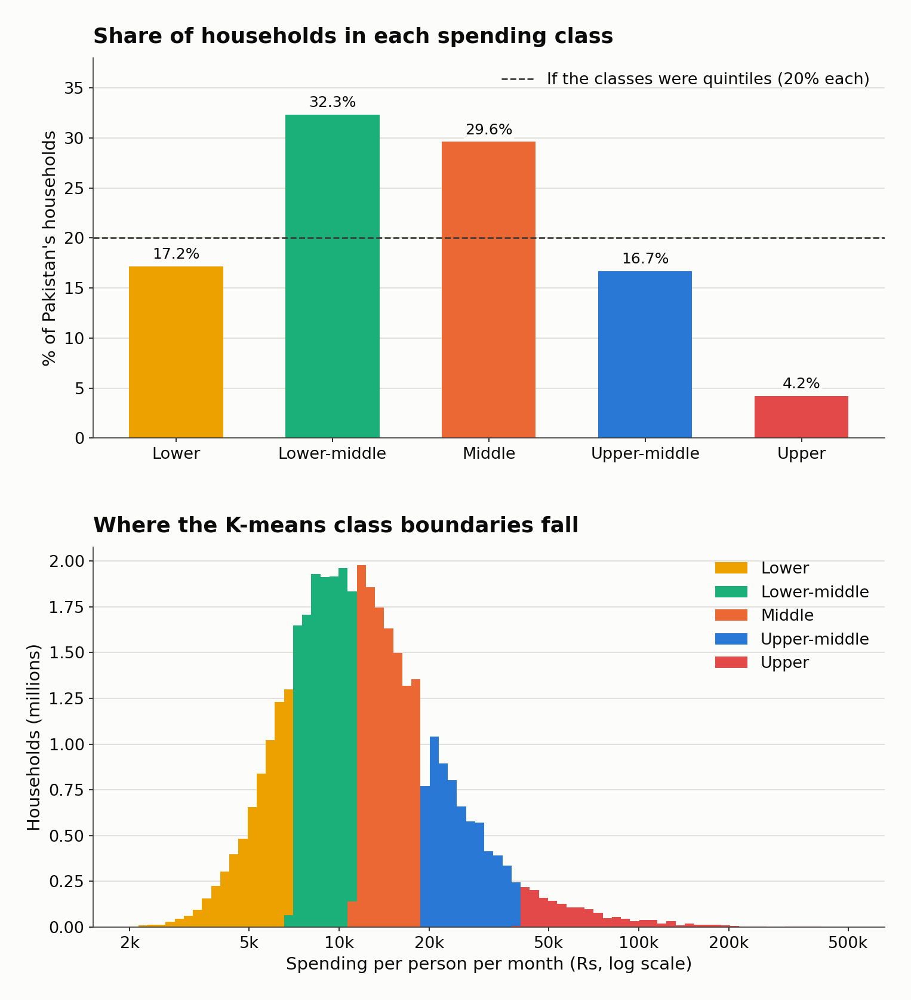

# Experiment 1: Five social classes from household spending (HIES 2024-25)

**Notebook:** [`social_classes_kmeans_knn.ipynb`](social_classes_kmeans_knn.ipynb). It has already been run, so the outputs are visible without re-running.
**Exact definition of the cut points:** [`HOW_CLASSES_ARE_DEFINED.md`](HOW_CLASSES_ARE_DEFINED.md), or the [PDF version with charts](HOW_CLASSES_ARE_DEFINED.pdf).

**Question:** Using Section 6A (consumption expenditure) and the survey weights, can machine learning divide Pakistan's households into 5 classes, and what share of households falls in each?

**Unit of analysis: the household.** All results are weighted by the household weight (`weight.dta`). The weights add up to **40.1 million households**, which represent **239.8 million people** (average household size 5.98).

## Method

1. Add up each household's spending from about 285 items, converted to a monthly amount, then divide by household size to **rank** households by spending per person.
2. Run **K-means weighted by households** to create 5 classes. KNN cannot create classes, because it needs labels to learn from.
3. Use **KNN** to test whether the classes can be recognised from the household's spending pattern.

## Result

| Class | Spending per person per month | Per person per day, 2023 PPP $ | % of households | Households |
|---|---|---|---:|---:|
| Lower | below Rs 6,999 | below $3.39 | 17.2% | 6.9 M |
| Lower-middle | Rs 6,999 – 11,399 | $3.39 – 5.51 | 32.3% | 13.0 M |
| Middle | Rs 11,399 – 19,120 | $5.51 – 9.25 | 29.6% | 11.9 M |
| Upper-middle | Rs 19,120 – 40,282 | $9.25 – 19.49 | 16.7% | 6.7 M |
| Upper | above Rs 40,282 | above $19.49 | 4.2% | 1.7 M |

$1 (2023 PPP) = Rs 67.96 in 2024-25 prices: the World Bank 2023 PPP factor for private consumption, adjusted by the CPI. Details are in [`HOW_CLASSES_ARE_DEFINED.md`](HOW_CLASSES_ARE_DEFINED.md).

**Fixed class lines used in the PDF: $3 / $6 / $10 / $20** per person per day (2023 PPP), the K-means thresholds above rounded. They give 11.6 / 43.8 / 26.8 / 13.9 / 4.0% of households, and 85% of households keep their K-means class. The PDF ([`HOW_CLASSES_ARE_DEFINED.pdf`](HOW_CLASSES_ARE_DEFINED.pdf)) uses these lines throughout. Its Table 3 profiles each class by durable ownership: for example, a car is owned by 0 / 1 / 5 / 18 / 52% of households from lower to upper class.

- **Most households are in the middle:** 62% are lower-middle or middle. Only 4% form a distinct upper class.
- **KNN recognises the class** from the spending pattern for 82.9% of households. Almost all of its mistakes are to a neighbouring class.
- **Clustering on *what* households buy** (12 categories) finds household types, mainly families with or without students, rather than classes.
- **Spending includes imputed consumption** (owned-home rent, own produce, wages and gifts in kind): 18.5% of household spending, from 17% to 24% by class. Without it, the lower class would be 32% of households instead of 17%. See [`HOW_CLASSES_ARE_DEFINED.md`](HOW_CLASSES_ARE_DEFINED.md).
- **Urban and rural households classified separately** split into the same class shapes (about 17 / 32 / 28 / 17 / 5%). Urban thresholds, however, are 1.4-1.9 times the rural ones. See the PDF, section 6.
- **Weights are required** for results that describe Pakistan. For these national shares they changed each class by only about 1 point, but they matter more for provinces.

## Adding income (Section 1B)

The class cut points are **spending per person**, not salaries. A household's money is shared by everyone in it:

| Class | People per household | Earners | Household spending / month | One worker's pay / month |
|---|---:|---:|---:|---:|
| Lower | 7.6 | 1.8 | Rs 38,300 | Rs 16,000 |
| Lower-middle | 6.5 | 1.6 | Rs 54,400 | Rs 22,900 |
| Middle | 5.5 | 1.5 | Rs 73,300 | Rs 30,000 |
| Upper-middle | 4.7 | 1.3 | Rs 108,400 | Rs 48,000 |
| Upper | 4.1 | 1.2 | Rs 229,900 | Rs 98,000 |

*(medians, weighted by household)*

- One earner on Rs 40,000 supporting 6 people gives about Rs 6,667 per person, which puts the household in the lower class.
- The median worker earns about Rs 25,000 a month. Only 28% earn Rs 40,000 or more.
- Income and spending agree (correlation 0.71), which supports the spending-based classes.

## Full income, and classes based on income (Step 8)

Section 1B counts **cash only**. To get a household's full income we add:

- **Transfers and property income** from other files: remittances, BISP, zakat, rent, and profit on savings.
- **Income in kind:** things the household used but never paid for in cash. This covers food it grew and ate, the rental value of a house it owns, wages paid in goods, and gifts received as goods. Spending already includes these, so income must include them too. They are worth Rs 15,100 a month for the average household.

Business and farm cash income are already in Section 1B. For self-employed people the Section 11 sheet profit matches their Section 1B earnings (median ratio 1.02), so they are not added again.

**With everything included, income is at least as high as spending in every class, and our totals match the official PBS report:**

| Average per household per month | Ours | PBS report 2024-25 |
|---|---:|---:|
| Income | Rs 84,057 | Rs 82,179 |
| Spending | Rs 81,351 | Rs 79,150 |

- **A household's spending is bigger than one worker's pay because the household has more income than that one pay.** The main earner brings in only about half (50-54%) of household income. The rest comes from other family members who work, remittances, BISP, rent and income in kind.

- **BISP** reaches 41% of lower-class households. **Remittances from abroad** reach 18% of upper-class households, compared with 3% of lower-class ones.
- **Classes by income** (19.6 / 33.7 / 28.1 / 14.4 / 4.2% of households) closely match **classes by spending** (17.2 / 32.3 / 29.6 / 16.7 / 4.2%). 68% of households land in the same class either way, and 98% in the same or a neighbouring class.

The notebook's last section lists the limitations: spending is not wealth, there is no adjustment for regional prices, and the five classes are cut points, not natural groups.

## Files

| File | What it is |
|---|---|
| `social_classes_kmeans_knn.ipynb` | The full experiment, with explanations |
| `HOW_CLASSES_ARE_DEFINED.md` | Short note: the exact steps and formulas behind every cut point |
| `HOW_CLASSES_ARE_DEFINED.pdf` | Methodology note *Consumption-Based Social Classes in Pakistan* (3 pages): how the classes are made in six plain steps, the class table (Rs per month and 2023 PPP $ per day) and chart, checks, imputed consumption by class, how to read the thresholds, and urban and rural households classified separately. The full formulas are in `HOW_CLASSES_ARE_DEFINED.md`. Built by `../reports/build_reports.py` |
| `outputs/household_classes.csv` | One row per household: spending, cash income, transfers, property income, income in kind, full income, earners, quintile, class, household weight. **Experiment 2 reads this file.** |
| `outputs/test_a_class_summary.csv` | The class table above |
| `outputs/test_a_classes.png` | Share of households in each spending class, and where the cut points fall |
| `outputs/household_vs_salary.png` | Household income split into main earner, other earners and other income, next to household spending |
| `outputs/income_sources.png` | Who gets BISP or remittances, and where each class's income comes from, compared with spending |
| `outputs/spending_vs_income_classes.png` | Classes by spending vs by income, and how often they agree |

## Re-running

From this folder, run `jupyter notebook social_classes_kmeans_knn.ipynb` and choose "Run All". It needs `pandas`, `scikit-learn`, `matplotlib` and the files in `../../HIES 2024_2025/Stata data/`. It takes about 3 minutes.
