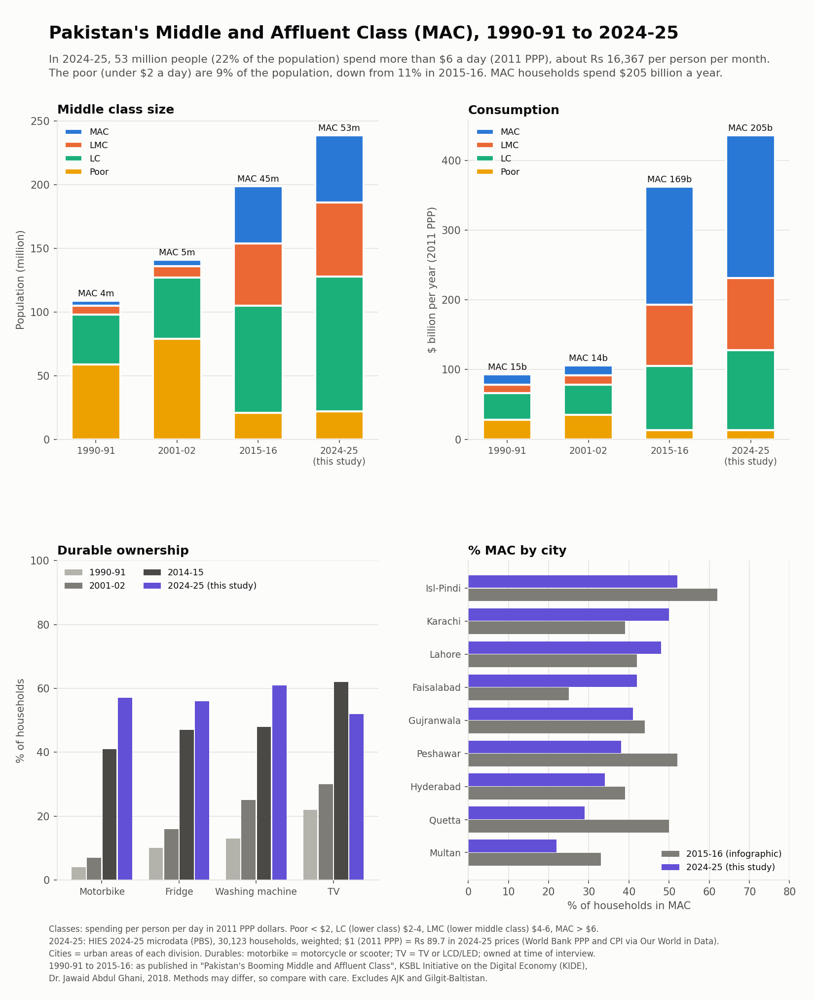

# Experiment 2: Middle and Affluent Class (MAC), the 2024-25 update of the 2018 KIDE infographic

**Notebook:** [`mac_infographic_2024_25.ipynb`](mac_infographic_2024_25.ipynb). Run Experiment 1 first; this notebook reads `../1_social_classes/outputs/household_classes.csv`.

It recreates the four panels of the original infographic, [`reference/2018 KIDE MAC.pdf`](reference/2018%20KIDE%20MAC.pdf), and adds 2024-25. It uses the same **fixed** class lines: spending per person per day in 2011 PPP dollars, with Poor < $2, LC $2-4, LMC $4-6, MAC > $6. $1 (2011 PPP) = Rs 89.7 in 2024-25 prices, using World Bank PPP and CPI figures.

| 2024-25 | Poor | LC | LMC | MAC |
|---|---:|---:|---:|---:|
| People (million) | 22 | 106 | 58 | 53 |
| % of people | 9% | 44% | 24% | 22% |

**In 2025 dollars:** the same lines are $2.75 / $5.51 / $8.26 a day, because $1 in 2011 = $1.38 in 2025 (World Bank PPP for 2024-25, Rs 65.1 per $). Class sizes don't change; MAC consumption is $205b in 2011 dollars = $283b in 2025 dollars. Using $2/$4/$6 *as* 2025 dollars would lower the lines and show MAC at 40%, so the report does not do that (Step 6b in the notebook).

The 1990-91, 2001-02 and 2015-16 values are typed in from the infographic, so compare with care. The MAC share is sensitive to the dollar conversion: it ranges from 18% to 27% if the rate moves ±10%.

## Files

| File | What it is |
|---|---|
| `mac_infographic_2024_25.ipynb` | The full calculation, with explanations |
| `outputs/mac_infographic_2024_25.png` / `.pdf` | The 2024-25 infographic (single page) |
| `outputs/MAC_report_2024_25.pdf` | **2-page report**: page 1 in the KIDE layout with text and data tables; page 2 with key figures, class lines in rupees, classes by area, ownership by class, method and cautions |
| `reference/2018 KIDE MAC.pdf` | The original 2018 infographic (KSBL, Dr. Jawaid Abdul Ghani) that this updates |

## Data to download for the other years

The same code can rebuild every year with one consistent method once these are in the project. Get them from the PBS microdata page (https://www.pbs.gov.pk/content/microdata). Some rounds require registration or a signed confidentiality form.

| Target year | Survey round to download |
|---|---|
| 1990 | HIES 1990-91, or the World Bank's Pakistan Integrated Household Survey 1991 (World Bank Microdata Library) |
| 1995 | HIES/PIHS 1996-97 (or the nearest 1990s round PBS offers) |
| 2000 | PIHS / HIES 2001-02 |
| 2005 | PSLM / HIES 2004-05 (or 2005-06) |
| 2010 | PSLM / HIES 2010-11 |
| 2015 | PSLM / HIES 2015-16 (HIICS) |
| 2020 | PSLM / HIES 2018-19 |
| 2025 | HIES 2024-25 ✔ already in `../../HIES 2024_2025/` |

For each round, download the **complete** package:

1. all household data files (Stata `.dta` if offered, otherwise SPSS `.sav`);
2. the questionnaire(s);
3. any codebook or manual.

The key files are the **roster**, **consumption expenditure** (Section 6), **durables** (Section 7), and the **weights**. Put each round in its own folder at the project root, named like the current one (e.g. `HIES 2018_2019/`).

## Re-running

1. Run Experiment 1 first (`../1_social_classes/social_classes_kmeans_knn.ipynb`).
2. From this folder, run `jupyter notebook mac_infographic_2024_25.ipynb` and choose "Run All". It also reads Section 7 (durables) from `../../HIES 2024_2025/Stata data/`.
